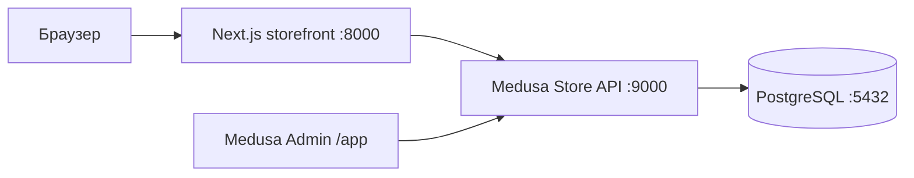

# Аналіз Medusa проєкту для навчання QA

Дата: 12 жовтня 2026. Основний репозиторій — `qa-commerce-automation-lab`, а `QA-AUTO-ROAD-MAP` — батьківська папка з інструкціями та `medusa-temp`. Нижче розрізняються факти конфігурації, виконані перевірки та гіпотези для дослідження.

## Архітектура і шлях даних

| Компонент | Реалізація | Роль |
|---|---|---|
| Monorepo | npm workspaces, Turborepo | Керує apps/backend та apps/storefront |
| Backend | Medusa 2.17.2, TypeScript, порт 9000 | Store/Admin API, commerce workflows, адмінка /app |
| Storefront | Next.js 15.5.18, React 19, Tailwind, порт 8000 | Каталог, варіанти, кошик, checkout, account, orders |
| Database | postgres:16-alpine, Docker, порт 5432 | medusa_db, volume postgres_data |
| UI automation | Playwright, Chromium | Один smoke-тест /de/store |
| CI | .github/workflows/playwright.yml | Install, Postgres, db:setup, сервери, тест, upload report |

Основні data-функції storefront позначені `use server`. Каталог читає `/store/products` через SDK на сервері Next.js. Браузерний Network не зобов'язаний містити цей прямий запит. Middleware окремо отримує `/store/regions`, визначає countryCode і робить redirect 307. SDK має fallback backend URL, але middleware вимагає `NEXT_PUBLIC_MEDUSA_BACKEND_URL`.

`src/lib/data/cart.ts` створює cart, додає/оновлює/видаляє items, задає адресу й доставку, ініціює payment session і викликає complete. Після створення order прибирає cart cookie та redirect на confirmed. `cookies.ts` містить httpOnly JWT/cart cookies й cache tags. Це основа для вивчення стану, кешування, авторизації та причин різниці між API і UI.

## Дані та seed

`npm run db:setup` спочатку запускає `medusa db:migrate`, потім `src/scripts/seed.ts`. У `src/migration-scripts/initial-data-seed.ts` є інший сценарій з товарами, доставкою, inventory і прив'язкою publishable key до sales channel. Міграційні data-скрипти виконуються через db:migrate; поведінку обліку їх виконання для встановленої версії слід перевірити на окремій чистій базі. [Medusa migrations](https://docs.medusajs.com/learn/fundamentals/data-models/write-migration)

Поточний звичайний seed визначає 11 товарів, чотири категорії та варіанти S/M/L, регіон Europe (de/fr/es/it), склад і ключ Storefront. Він пропускає вже наявні handles, але не оновлює ціни/варіанти існуючих товарів. Категорії активує. При створенні власного ключа не прив'язує його до sales channel; це не доводить проблему чинного ключа в локальному env. Частина потрібної checkout-конфігурації знаходиться в міграційному seed, тому їх потрібно розглядати разом.

Зображення локальні, файли з seed присутні в apps/backend/static. Назви товарів не доводять правильність ціни чи inventory. Системний payment provider у seed не є доказом інтеграції з реальним платіжним процесором.

## Що фактично перевірено

- Playwright `test --list`: один тест `store page displays products`, Chromium. Він перевіряє heading All products і текст Medusa T-Shirt, без кошика або checkout.
- Turbo `test --dry=json`: обидва workspace tasks мають command `<NONEXISTENT>`. Отже, поточний npm test не запускає root Playwright-тест.
- Локальні backend .env та storefront .env.local існують, потрібні ключі в них задані. Значення не виводилися; живий запуск і smoke підтвердили базову працездатність, але не всі auth/CORS сценарії. В обох apps немає .env.example.
- Після запуску учнем: compose ps показує qa-commerce-postgres Up (healthy). Дозволені HTTP-перевірки /health на 9000, /de/store та /dk/products/sweatshirt на 8000 дали 200. Початковий HTTP 000 у sandbox не відображав доступність сервісів поза ним.
- В оточенні Node 26.4.0, npm 11.17.0; CI задає Node 20. Відмінність версій зафіксована, несумісність не доведена.
- Git раніше не виконався через Xcode license; гілка прочитана з .git/HEAD: feat/playwright-setup. Git status та remote CI-результати не підтверджено.

Наявний UI smoke виконано: 1 passed (619ms). Перший запуск Chromium у sandbox заблоковано системними дозволами; повторний дозволений запуск успішний. Повний build, checkout E2E, міграції та seed не виконувалися; робочі дані не змінювалися.

SELECT до живої бази підтвердив PostgreSQL 16.14, 143 public base tables і 15 товарів без deleted_at. Є як початкові Medusa Sweatshirt/Shorts/Sweatpants, так і товари звичайного seed. Каталог не можна описувати лише 11 визначеннями з seed.

Учень встановив DBeaver, успішно підключився та відкрив структуру account_holder. Поточна картка /dk/products/sweatshirt на скриншоті має From €10.00 та Out of stock без вибраного розміру. Причина цього напису й доступність конкретного варіанта поки не перевірені. Admin login та checkout не підтверджені цим аудитом.

## Підтверджені прогалини конфігурації

| Пріоритет | Факт | Наслідок і наступна перевірка |
|---|---|---|
| P1 | Workflow не задає env і не створює env-файли; локальні env ігноруються Git | Чистий CI не має задокументованого DATABASE_URL/CORS і publishable key; перевірити bootstrap на ізольованій базі |
| P1 | npm test веде до workspaces без test-скриптів | Додати окрему root команду Playwright і перевірити, що вона знаходить та виконує тест |
| P1 | Readiness backend використовує `/`, не `/health` | Перевірити HTTP-відповідь root і використати endpoint готовності; відкрита TCP-сесія теж не доводить готовність API |
| P2 | Немає explicit HTML reporter, але CI завантажує playwright-report | Налаштувати report і upload артефактів діагностики, перевірити після реального запуску |
| P2 | trace on-first-retry при відсутності retries у конфігурації | Без CLI retries перший retry не відбудеться; вибрати режим збору trace для реальної діагностики |
| P2 | Next build ігнорує TypeScript та ESLint помилки | Успішний build не є перевіркою типів; додати окремі checks під час модуля CI |
| P2 | Jest setup посилається на відсутній файл | Наявність test:integration скриптів не означає готовий набір backend-тестів |
| P2 | README містить лише назву; roadmap/API/architecture/CI/SQL docs порожні | Поступово заповнювати результатами практики та відтворюваними інструкціями |

## Гіпотези для навчального дослідження

1. **Одиниці ціни.** Звичайний seed задає T-Shirt amount 1999, hoodie 6499 тощо, а formatter передає amount прямо в Intl.NumberFormat. Medusa v2 зберігає ціни в основних одиницях валюти. Якщо вимога — футболка €19.99, значення 1999 суперечить їй. Потрібно погодити очікувану ціну, прочитати API та перевірити UI; чинний товар може мати ціну з іншого seed. [Medusa v2 pricing](https://docs.medusajs.com/learn/introduction/from-v1-to-v2)
2. **Повторний seed.** Два сценарії використовують різні ключі й правила створення. Перевірити fresh setup та повторний звичайний seed на тестовій базі: дублікати, незмінені товари, канали, inventory, доставка.
3. **Каталог понад 100 товарів.** listProductsWithSort отримує максимум 100 і використовує products.length для count. На більшому наборі перевірити повноту, сортування та пагінацію; на поточних 15 товарах цей край не проявляється.
4. **Помилка add-to-cart.** handleAddToCart встановлює isAdding=true і повертає false тільки після успішного await, без finally. Перевірити UI при відхиленому server action; це кандидат на завислу кнопку, а не відтворений дефект.
5. **Регіон і кеш.** DEFAULT_REGION у коді dk, але звичайний seed має de/fr/es/it; middleware має fallback. Перевірити redirect і доступність ціни, не оголошувати відмінність автоматичним дефектом.

## Черга робіт

Docker уже працює й baseline одного smoke отримано. Далі перевірити Git/Xcode окремо, без повторного налаштування працюючого середовища. Далі підготувати clean bootstrap та команди тестування/репорти; це технічна робота ментора з поясненням учню. Учень паралельно виконує модулі 0–3. SQL-lab створювати окремо від medusa_db, коли дійдемо до модуля 4. Після цього додавати API fixtures і автоматизацію критичних сценаріїв.

Не потрібні зараз: переписування магазину, оновлення всіх залежностей, Kubernetes, власний AI backend або набір десятків MCP. Навчальна цінність проєкту — доступ до UI, API, даних і реальних інтеграційних питань в одному середовищі.

## Оцінка навчальних матеріалів після запуску

Послідовність web → API → дані → автоматизація залишається корисною. Перший варіант плану недооцінював користь раннього SELECT для учня з MSSQL досвідом і починав з установки, яку вже виконано. Тепер перше заняття зв’язує реальний товар, UI і базу; повна SQL-лабораторія залишається окремим модулем.

Skill тепер прямо враховує прохання учня виконувати запуск самому. Progress відділяє практику з підказками від самостійності й аудиту агента. AI tools використовує DBeaver як поточний клієнт і не додає database MCP без потреби. Ще потрібно перевірити навчальну поведінку skill на роботі учня; валідний YAML і зелений smoke цього не доводять.
